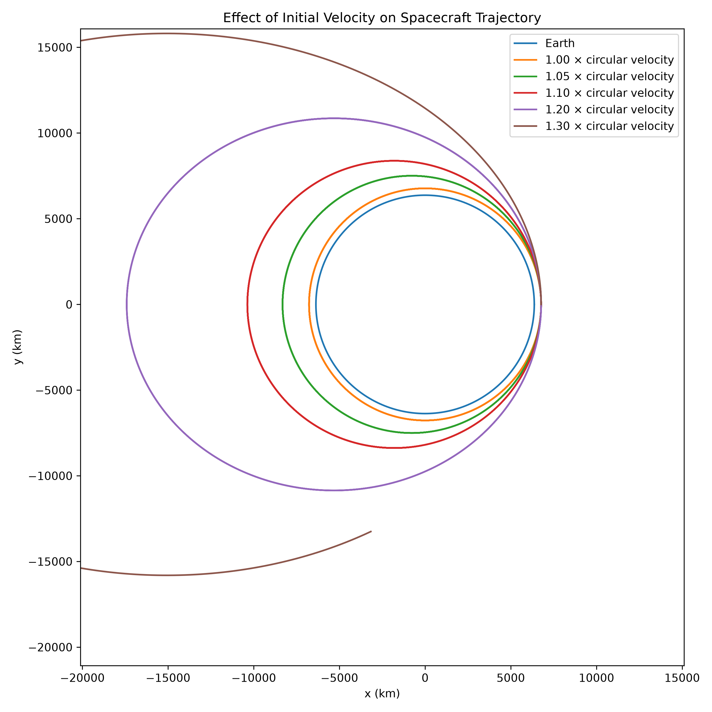
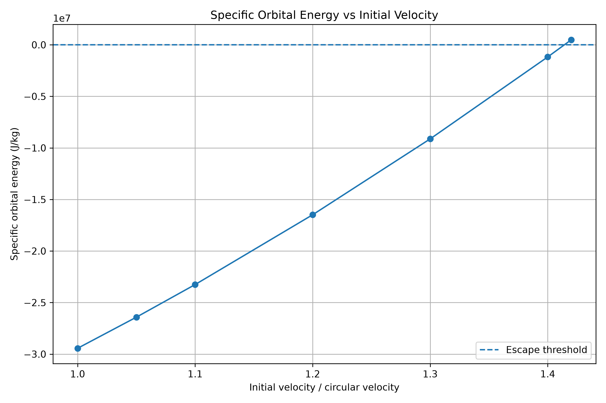
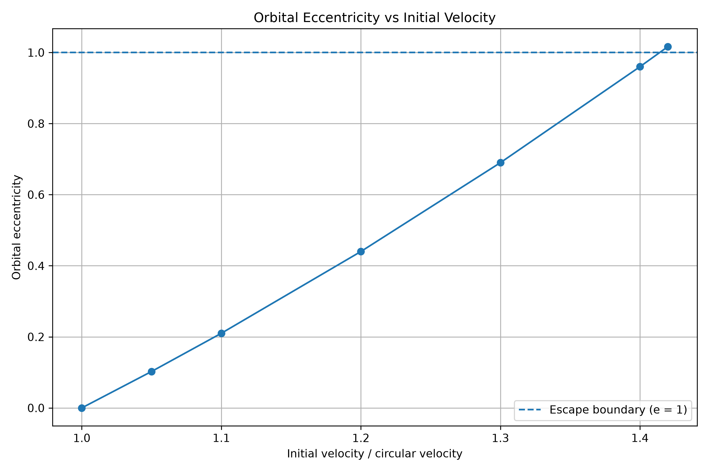
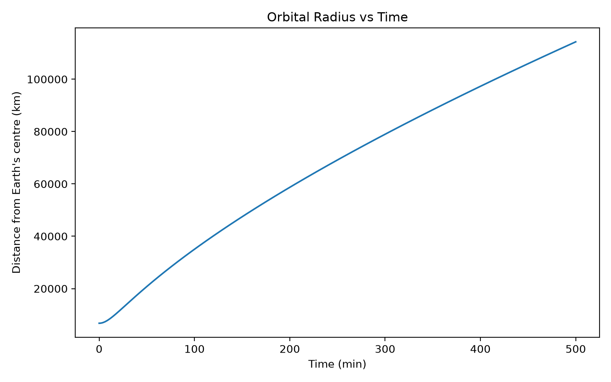
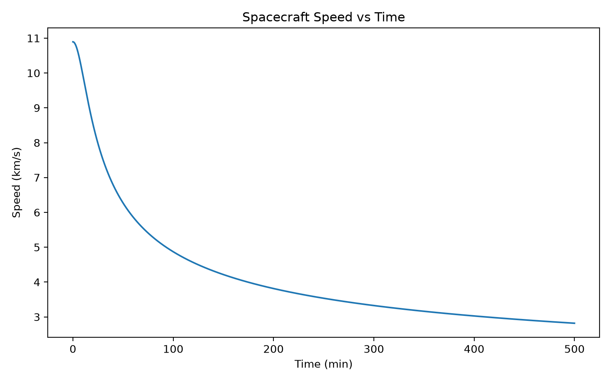

# Orbital Mechanics Simulator

A computational physics project written in Python investigating how a spacecraft's initial velocity affects its orbital energy, eccentricity, and trajectory around Earth.

## Research Question

How does increasing the initial tangential velocity of a spacecraft from a 400 km Earth orbit affect its orbital energy, eccentricity, and trajectory?

## Physics

The simulation uses Newtonian two-body gravity to model spacecraft motion around Earth.

The circular orbital velocity is:

v_c = √(GM/r)

The escape velocity is:

v_esc = √(2GM/r)

Therefore:

v_esc ≈ 1.414 × v_c

Specific orbital energy is calculated using:

ε = v²/2 − GM/r

Negative energy corresponds to a bound orbit, while zero or positive energy corresponds to an escape trajectory.

## Method

The simulation:

- Models Earth as a spherical body with a fixed mass.
- Places a spacecraft at an altitude of 400 km.
- Calculates the circular orbital velocity.
- Tests initial velocities from 1.00 to 1.42 times the circular velocity.
- Uses a velocity-Verlet numerical integration method.
- Calculates orbital energy and eccentricity.
- Compares spacecraft trajectories for different initial velocities.

## Results

The simulation showed that increasing the initial velocity causes:

- Increasing orbital energy.
- Increasing orbital eccentricity.
- Increasingly elongated elliptical orbits while the spacecraft remains bound.
- A transition from a bound orbit to an unbound trajectory near the theoretical escape velocity.

At 1.40 times the circular velocity, the spacecraft remained bound.

At 1.42 times the circular velocity, the calculated specific orbital energy became positive and the trajectory became unbound.

This agrees with the theoretical escape velocity ratio of approximately 1.414 times the circular velocity.

## Figures

### Trajectory Comparison

### Orbital Energy

### Orbital Eccentricity

### Orbital Radius vs Time

### Speed vs Time

## Data

The numerical results are stored in `orbital_results.csv`.

## Technologies

- Python
- NumPy
- Matplotlib

## Limitations

This model assumes:

- Newtonian two-body gravity.
- A spherical Earth.
- No atmospheric drag.
- No influence from the Moon or Sun.
- No spacecraft thrust or fuel consumption.
- No Earth's non-spherical gravitational effects.
- A finite numerical time step.

## Future Improvements

Possible extensions include:

- Hohmann transfer simulations.
- Atmospheric drag.
- Earth's J2 gravitational perturbation.
- Lunar influence.
- Comparison of different numerical integration methods.
- Simulating spacecraft propulsion and fuel requirements.

## Author

Levin Sherin

University of Auckland